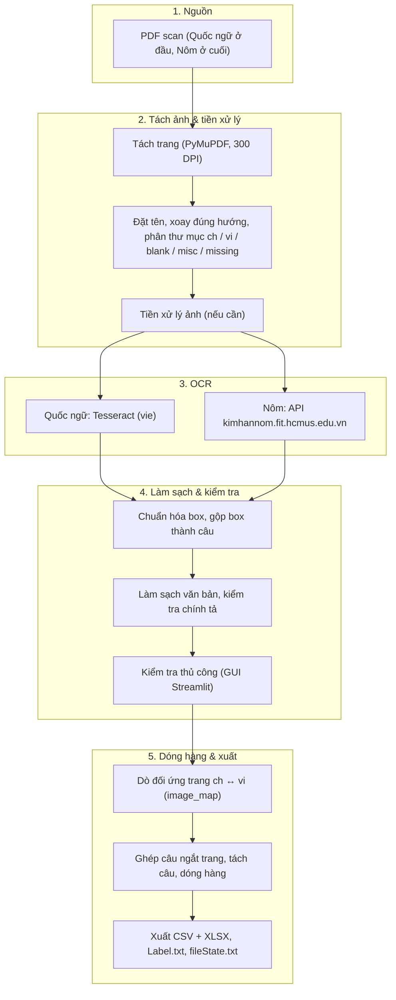

# Dóng hàng dữ liệu song song Hán Nôm – Quốc ngữ

Đồ án xây dựng **bộ dữ liệu song song Hán Nôm – Quốc ngữ** từ sách scan, theo tài liệu _Hướng dẫn xây dựng dữ liệu song song Hán Nôm và Quốc ngữ_ (phiên bản v2.3, 13/11/2026).

## 1. Thông tin đề tài

| Mục                                    | Nội dung                                             |
| -------------------------------------- | ---------------------------------------------------- |
| Tên sách (đúng như file PDF được giao) | Sách Truyện Các Thánh                                |
| Mã đề tài / phạm vi được giao          | toàn bộ chương được giao (Tháng 1, Tháng 2, Tháng 3) |
| Loại sách                              | **T1**: Quốc ngữ ở đầu file, Nôm ở cuối file         |
| Nôm in hay viết tay                    | `TODO` (T1 hay T1w)                                  |
| Dạng nguồn                             | Scan cả hai bản (ảnh Nôm và ảnh Quốc ngữ)            |
| Kiểu dịch                              | **Dịch nghĩa** (không phải dịch âm 1–1)              |
| Nhóm                                   | `TODO`: họ tên, MSSV, email sinh viên                |

### Hệ quả của việc sách là T1 và dịch nghĩa

- **Thứ tự đọc:** Quốc ngữ đọc xuôi (trang tăng dần). Nôm đọc **ngược từ cuối sách**, nên số trang trong tên file **giảm dần** theo thứ tự đọc. Ví dụ: trang 001 Quốc ngữ ↔ trang 010 Nôm, trang 002 ↔ trang 009. Có thể 1 trang Quốc ngữ ứng với 2 trang Nôm.
- **Bản chụp 2 trang:** Nôm–Nôm thì trang **phải** đọc trước. Quốc ngữ–Quốc ngữ thì trang **trái** đọc trước.
- **Cột `text_diff` của mọi hàng luôn là `null`** (đúng bốn chữ `null`, không để trống, không ghi `[]`).
- **Không tô màu** trong file `.xlsx` (đỏ, vàng, đen chỉ dùng cho dịch âm).
- Công thức độ tương đồng ≥ 95% **không áp dụng**; tiêu chí đánh giá do các thầy điều chỉnh cho sách này.
- Dóng hàng dựa trên **quan hệ ngữ nghĩa** (tên riêng, con số, nội dung), không dựa trên số chữ.

## 2. Tổng quan pipeline



## 3. Cài đặt

### Yêu cầu hệ thống

- **Python** `>= 3.12, < 3.14`
- **uv** để quản lý môi trường và thư viện
- **Tesseract OCR** kèm dữ liệu tiếng Việt (`vie`), dùng cho OCR Quốc ngữ:
  - Ubuntu/Debian: `sudo apt update && sudo apt install -y tesseract-ocr tesseract-ocr-vie`
  - Arch: `sudo pacman -S tesseract tesseract-data-vie`
  - macOS (Homebrew): `brew install tesseract tesseract-lang`
  - Windows: tải bộ cài từ [UB-Mannheim Tesseract](https://github.com/UB-Mannheim/tesseract/wiki), chọn dữ liệu `vie.traineddata` và thêm vào `PATH`.

### Các bước

```bash
git clone https://github.com/ChungDat/-26-27-NLP-Viet-SinoNom-Sentence-Alignment.git
cd -26-27-NLP-Viet-SinoNom-Sentence-Alignment   # thư mục trùng tên repo
uv sync                                          # cài thư viện theo uv.lock (đã pin phiên bản)
```

### Biến môi trường

Module OCR Nôm gọi API của `https://kimhannom.fit.hcmus.edu.vn/` và cần token xác thực. Tạo file `.env` ở thư mục gốc (file này không được commit):

```env
TOKEN="your_kimhannom_jwt_token_here"
```

## 4. Chạy ứng dụng

```bash
uv run streamlit run src/gui.py
```

Giao diện cho phép: tải tài liệu, chọn khoảng trang để tách ảnh, chỉnh tham số tiền xử lý theo thời gian thực, xem bounding box, chạy OCR, và xem hoặc sửa văn bản trước khi lưu kết quả trung gian.

## 5. Các bước chi tiết

### Bước 1. Xác nhận phạm vi và kiểm tra nguồn

- Xác nhận tên sách, phạm vi được giao, nguồn Nôm và Quốc ngữ. Chưa chắc hai bản cùng phạm vi thì chưa OCR hàng loạt.
- Nếu hơn 20% trang Nôm rách hoặc mờ thì báo người giao tài liệu trước khi làm.

### Bước 2. Tách PDF thành ảnh và phân loại

- Dùng `src/extraction.py` (PyMuPDF), mặc định 300 DPI, **giữ độ phân giải gốc càng cao càng tốt**.
- Tên ảnh: `<Tên sách>.<Số trang>[_<Số ảnh>].jpg`
  - Số trang có ít nhất 3 chữ số (001, 011, 111), đánh từ 1 theo thứ tự trong file PDF đang dùng (`_updated.pdf` nếu có, không thì PDF gốc). Từ 1000 trở lên không thêm số 0.
  - Bản chụp 2 trang tính là 1 ảnh, 1 số trang.
  - `_<Số ảnh>` chỉ thêm khi một trang có hơn 1 ảnh Nôm hoặc Quốc ngữ, đánh theo **thứ tự đọc**.
  - Chỉ dùng định dạng JPG.
- Kiểm tra và xoay đúng hướng toàn bộ ảnh (kể cả trang trắng và bìa).
- Phân vào thư mục: `ch`, `vi`, `intro`, `ref`, `toc`, `blank`, `misc`, `missing/ch`, `missing/vi`.
- Nếu có chỉnh ảnh (sáng, nét, xoay) thì phải ghép lại thành `<Tên sách>_updated.pdf` và báo người giao sách.

### Bước 3. Phát hiện trang mất do scan

Dựa vào **số trang in sẵn** trên sách (không dựa vào số trang trong PDF):

| Tình huống                                                                        | Xử lý                                                                                                                  |
| --------------------------------------------------------------------------------- | ---------------------------------------------------------------------------------------------------------------------- |
| Bản Nôm gốc vốn thiếu trang (bản dịch cũng không có, hoặc dịch giả ghi chú thiếu) | Không xử lý gì                                                                                                         |
| Mất trang Nôm, còn bản dịch Quốc ngữ                                              | Chuyển ảnh Quốc ngữ sang `missing/vi`, không OCR, không đưa vào dóng hàng                                              |
| Mất bản dịch, còn trang Nôm                                                       | Ảnh Nôm lưu ở cả `ch` và `missing/ch`, vẫn OCR. Với sách dịch nghĩa, việc tổng hợp bản dịch dự đoán cần hỏi thầy trước |

Mọi trang mất do scan đều ghi vào `image_map`.

### Bước 4. Tiền xử lý ảnh (tùy chọn)

- `src/preprocess.py`: khử nhiễu nền, nhị phân hóa, giãn và co hình thái (dilation/erosion). Tham số lưu ở `src/preprocess_settings.json`.
- Chỉ dùng khi cải thiện kết quả OCR. Nhớ quy định về `_updated.pdf` ở Bước 2.

### Bước 5. OCR

- **Quốc ngữ:** `src/ocr_viet.py` (PyTesseract, ngôn ngữ `vie`).
  - Quy định yêu cầu Quốc ngữ **chính xác tuyệt đối**. Sách T1 thường là bản dịch cũ (dấu thanh cũ, từ cổ, in mờ) nên Tesseract có thể chưa đủ. Nên thử thêm OCR đa năng (Qwen-VL, PaddleOCR-VL, Vintern…) và voting 2–3 mô hình. _(chưa làm)_
- **Nôm:** `src/ocr_sino_nom.py` gọi API kimhannom: `image-upload → structure-classification → image-ocr`.
  - Giới hạn: 25 lượt/phút, 50/giờ, 200/ngày, 600/tuần. Mỗi ảnh cần ít nhất 2 lượt nên phải lập kế hoạch và đặt độ trễ giữa các request.
  - Nếu bounding box từ `image-ocr` không hợp lệ: chỉnh lại box, cắt từng dòng rồi dùng `image-rec`.
- Nên thử trên vài ảnh mẫu trước khi chạy cả sách.

### Bước 6. Bounding box và làm sạch

**Bounding box (định dạng PPOCRLabel):**

- **Mỗi box đúng 4 điểm.** Tọa độ tính trên đúng ảnh được nộp; nếu ảnh bị xoay, ghép hoặc đổi kích thước thì phải quy đổi lại.
- Nôm: đánh theo từng cột dọc, thứ tự **phải sang trái**, trên xuống dưới. Chú thích chữ nhỏ hai cột thì đánh 2 box.
- Quốc ngữ: theo hàng hoặc đoạn (hoặc 1 box cho cả trang), thứ tự trái sang phải, trên xuống dưới.
- Bỏ: số trang, tên sách, tiêu đề hoặc chân trang, dấu thư viện, ghi chú ngoài khung, tranh ảnh. Giữ tiêu đề chương mục thuộc nội dung chính nếu có bản dịch. Bảng biểu vẫn OCR.
- Trang rách: chỉ đánh tới ranh giới rách. Trang mờ nhưng đọc được: đánh bình thường.

**Làm sạch văn bản:**

- Chung: loại dòng trùng do OCR lặp vùng; bỏ chú thích chân trang, chỉ mục như `[1]`, `(1)`, ghi chú dịch giả chèn giữa bản dịch; sửa ký tự rác và khoảng trắng bất thường; giữ nguyên tên riêng, niên hiệu, con số.
- Nôm: viết liền, không tự thêm dấu câu. Chữ chưa có trong Unicode hoặc font thì ghi `〓` (U+3013), mỗi `〓` thay đúng một chữ, và liệt kê trong báo cáo.
- Quốc ngữ: giữ nguyên cách viết gốc (từ cổ, dấu cũ như _Sài-Gòn_, _kỹ-sư_), chỉ sửa lỗi OCR. Từ ngắt bằng gạch ngang cuối dòng thì ghép lại và bỏ gạch (trừ tên riêng hoặc từ vốn có gạch nối như _A-ve_). Các dòng nối bằng 1 khoảng trắng.
- **Không có ký tự xuống dòng trong ô CSV/XLSX** (cả Nôm lẫn Quốc ngữ).
- Chữ Nôm lem, nhòe không thấy: dùng `[MASK]`. Quy định gốc viết cho dịch âm, nên cần hỏi thầy trước khi áp dụng cho sách dịch nghĩa.

### Bước 7. Dò đối ứng trang và tạo `image_map`

- Hai bản không theo thứ tự 1–1 theo số trang, nên phải dò đối ứng bằng nội dung (tên riêng, con số, tiêu đề).
- File `<Tên sách>_image_map.json` (không bắt buộc nhưng nên làm):
  ```json
  {
    "pairs": [
      { "ch": ["Sách.010.jpg"], "vi": ["Sách.001.jpg"] },
      { "ch": ["Sách.009.jpg"], "vi": ["Sách.002.jpg"] },
      { "ch": ["Sách.008.jpg", "Sách.007.jpg"], "vi": ["Sách.003.jpg"] },
      {
        "ch": ["Sách.020.jpg"],
        "vi": [],
        "note": "Trang Quốc ngữ tương ứng bị mất khi scan"
      }
    ]
  }
  ```
- Các cặp sắp theo thứ tự đọc của bản Quốc ngữ. Trong vế `ch`, ảnh Nôm theo thứ tự đọc (số trang giảm dần). Hai vế không được cùng rỗng; một vế rỗng nghĩa là trang mất do scan.

### Bước 8. Ghép câu, tách câu, dóng hàng

- **Ghép câu bị ngắt do chuyển trang trước khi tách câu.** Với phần Nôm T1, câu ngắt ở cuối ảnh N tiếp tục ở đầu ảnh N−1. Câu ghép lấy `img_id` của ảnh chứa phần đầu câu; ảnh kế tiếp bắt đầu đánh số từ câu đầu tiên sau phần được nối.
- Dấu gợi ý (không tuyệt đối): Nôm `。！？；：`, Quốc ngữ `.?!;:` kết hợp ngữ nghĩa (chú ý chữ viết tắt, số thứ tự, tên riêng có dấu chấm). Không tách câu quá ngắn (dưới khoảng 1–3 chữ).
- Kiểu dóng hàng: **1–1** (ưu tiên), **1–n**, **n–1**, **n–m** (chỉ khi bản dịch tái cấu trúc mạnh). Với n–1 và n–m, `sentence_id` là của câu Nôm đầu tiên được gộp. Ưu tiên đơn vị nhỏ nhất vẫn đủ nghĩa.
- Một cặp đúng khi: cùng nội dung; không mất ý quan trọng; không thêm nội dung của câu khác; tên riêng, chức danh, địa danh, thời gian, niên hiệu, con số tương ứng; ranh giới hợp lý; không ghép nhầm tiêu đề, số trang hay rác OCR.
- Mọi thứ (ghép câu, `sentence_id`, sắp xếp hàng) theo **thứ tự đọc của sách**.
- Luôn dóng hàng các trang có bản dịch, kể cả bìa và mục lục.
- Module: `src/aligning.py`.

### Bước 9. Xuất file dóng hàng

File `<Tên sách>.csv` (UTF-8 **có BOM**) và `<Tên sách>.xlsx`, cùng 5 cột:

| Cột           | Nội dung                                                                             |
| ------------- | ------------------------------------------------------------------------------------ |
| `img_id`      | Tên ảnh, không có thư mục                                                            |
| `sentence_id` | `<img_id bỏ .jpg>.<n>`, n là số thứ tự câu Nôm trên trang, từ 1 (ví dụ `Sách.024.1`) |
| `ch_txt`      | Văn bản Hán Nôm                                                                      |
| `vi_txt`      | Văn bản Quốc ngữ                                                                     |
| `text_diff`   | Luôn là `null` (dịch nghĩa)                                                          |

- Ghi bằng thư viện `csv` hoặc `pandas`, không tự ghép chuỗi.
- Chuẩn hóa Unicode **NFC** cho cả hai vế.
- `.xlsx` không tô màu.

## 6. Kiểm tra tự động trước khi nộp

- [ ] **Ảnh:** tên đúng cú pháp, đúng hướng, không trùng, chỉ JPG.
- [ ] **`Label.txt`, `fileState.txt`:** mở được bằng PPOCRLabel, mỗi box đúng 4 điểm, mọi dòng `fileState.txt` là `1`, mọi ảnh trong thư mục có dòng trong `Label.txt`.
- [ ] Văn bản `Label.txt` (nối theo thứ tự đọc) khớp với file dóng hàng, trừ các câu ghép do ngắt trang.
- [ ] **CSV/XLSX:** mở được bằng Excel hoặc Google Sheets, không lỗi font, không lệch cột.
- [ ] Mọi `text_diff` = `null` (không có `[]`).
- [ ] Không có ký tự xuống dòng trong ô; không có hàng nào hai vế cùng rỗng; không lẫn số trang, tiêu đề hay rác OCR.
- [ ] `sentence_id` đúng định dạng và theo thứ tự đọc.
- [ ] **`image_map`:** JSON hợp lệ; mọi tên ảnh tồn tại (`ch` hoặc `missing/ch`, `vi` hoặc `missing/vi`); không trùng trong cùng vế; không cặp nào hai vế rỗng; thư mục `missing` khớp với các cặp có một vế rỗng.
- [ ] Quốc ngữ đã kiểm tra chính tả (không sửa từ cổ và cách viết gốc).

## 7. Cấu trúc thư mục nộp

```text
<MSSV1_MSSV2_MSSV3_MSSV4>.zip
├── <Tên sách>/                      # tên y hệt tên file PDF được giao
│   ├── ch/                          # ảnh Nôm + Label.txt + fileState.txt
│   ├── vi/                          # ảnh Quốc ngữ + Label.txt + fileState.txt
│   ├── intro/, ref/, toc/           # tùy chọn; nếu nộp phải có Label.txt + fileState.txt
│   ├── blank/                       # trang trắng, không có chữ cần OCR
│   ├── misc/                        # bìa, trang không liên quan
│   ├── missing/ch/, missing/vi/     # trang mất do scan (không có Label/fileState)
│   ├── <Tên sách>.pdf               # bắt buộc
│   ├── <Tên sách>_updated.pdf       # nếu có chỉnh ảnh
│   ├── <Tên sách>_image_map.json    # nên làm
│   ├── <Tên sách>.xlsx              # bắt buộc
│   └── <Tên sách>.csv               # bắt buộc
├── <MSSV1_MSSV2_MSSV3_MSSV4>_report.pdf
├── source.zip                       # mã nguồn
└── extras.zip                       # tùy chọn, phải nêu trong báo cáo
```

Lưu ý: nếu trong quá trình xử lý tên sách bị mã hóa (ví dụ `Lorem%20ipsum`) thì khi nộp phải trả về đúng `Lorem ipsum`.

## 8. Báo cáo

File PDF, tên theo tên file zip, gồm:

- Họ tên, MSSV, email sinh viên của từng thành viên.
- Mô tả công việc đã làm (mô hình, quy trình).
- Tổng số cặp dịch nghĩa và tỷ lệ trên tổng số cặp.
- Tỷ lệ chữ tô vàng (bằng 0 vì không có dịch âm) và tỷ lệ hàng `null`.
- Danh sách các chữ `〓` (vị trí, mô tả cấu tạo).
- Trích dẫn (nếu có).
- **Phụ lục 4 ảnh chụp:** một trang Nôm và một trang Quốc ngữ mở bằng PPOCRLabel (đúng format, box đúng vị trí); một trang tính `.xlsx` (không lỗi font); một trang tính `.csv` mở bình thường (không lệch cột).

## 9. Tiến độ

- [x] **a. OCR Quốc ngữ:** `src/ocr_viet.py` (PyTesseract).
- [x] **b. Tích hợp OCR Nôm:** upload ảnh, phân loại bố cục, OCR qua API kimhannom (`src/ocr_sino_nom.py`).
- [x] **c. Giao diện và kiểm tra thủ công:** Streamlit (`src/gui.py`).
- [ ] **d. Đặt tên ảnh, phân thư mục, phát hiện trang mất do scan.**
- [ ] **e. Gộp bounding box thành câu** (gom theo tọa độ).
- [ ] **f. Xuất PPOCRLabel:** `Label.txt`, `fileState.txt`.
- [ ] **g. Làm sạch văn bản** và kiểm tra chính tả Quốc ngữ (từ điển hoặc mô hình, có thể dùng AI hỗ trợ).
- [ ] **h. Dò đối ứng trang** và tạo `image_map.json`.
- [ ] **i. Ghép câu ngắt trang, tách câu và dóng hàng** (`src/aligning.py`).
- [ ] **j. Xuất `.csv` (UTF-8 BOM) và `.xlsx`** đúng 5 cột.
- [ ] **k. Script kiểm tra tự động** trước khi nộp (mục 6).
- [ ] **l. Benchmark tiền xử lý và OCR** (CER, WER qua `src/metric.py`): chỉ để nhóm đánh giá nội bộ, không phải tiêu chí nộp.
- [ ] **m. Thử thêm OCR đa năng cho Quốc ngữ** và voting.
- [ ] **n. Báo cáo PDF, `USER_GUIDE.md`, `source.zip`.**

## 10. Cấu trúc mã nguồn

```text
.
├── pyproject.toml               # khai báo dự án uv và thư viện
├── uv.lock                      # khóa phiên bản thư viện (pinned)
├── README.md
├── USER_GUIDE.md                # TODO: hướng dẫn chạy pipeline từ đầu đến cuối trên máy mới
├── .env                         # token API (không commit)
├── .gitignore
├── src/
│   ├── gui.py                   # giao diện Streamlit
│   ├── extraction.py            # tách PDF thành ảnh độ phân giải cao
│   ├── preprocess.py            # tiền xử lý hình thái, nhị phân hóa
│   ├── preprocess_settings.json # cấu hình tiền xử lý đã lưu
│   ├── ocr_viet.py              # OCR Quốc ngữ (Tesseract)
│   ├── ocr_sino_nom.py          # client API kimhannom
│   ├── metric.py                # CER, WER
│   ├── aligning.py              # dóng hàng câu
│   └── benchmark_viet.py        # benchmark OCR Quốc ngữ
├── Nom_Font/                    # font Hán Nôm
├── Dong_hang/                   # kết quả cuối để nộp (theo cấu trúc ở mục 7)
└── dictionaries-*/              # từ điển, font tham khảo
```

## 11. Môi trường đã chạy

> `TODO` (cần cho `USER_GUIDE.md`): phiên bản Python, hệ điều hành (ưu tiên Ubuntu), RAM, GPU nếu có. Với công cụ hoặc mô hình có tính phí: ghi rõ mô hình, prompt đã dùng và cách cài token.

## 12. Tài liệu tham khảo

- Hướng dẫn xây dựng dữ liệu song song Hán Nôm và Quốc ngữ, v2.3 (13/11/2026).
- Công cụ chuyển tự và OCR Hán Nôm: https://kimhannom.fit.hcmus.edu.vn/
- PPOCRLabel (công cụ đánh nhãn bounding box).

## 13. Note trích xuất ảnh

Phần chữ Nôm của Tháng 2 bị mất 3 trang (1 trang trống/234 và 2 trang nội dung/ 295, 296, 315, 316, ), trùng (424, 425)

Phần Quốc ngữ của Tháng 3 có offset 2, phần chữ Nôm offset 3
