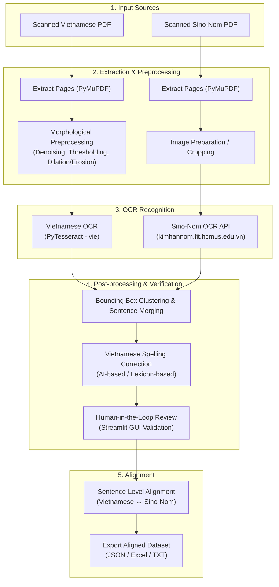

# Vietnamese - Sino-Nom Document Alignment

## 1. Introduction

This project focuses on **bilingual sentence and text alignment between modern Vietnamese and Sino-Nom (Hán Nôm)** historical texts. The primary source data consists of scanned historical documents in PDF format containing parallel or related Sino-Nom scripts and modern Vietnamese translations.

Because historical and scanned documents often suffer from degradation, scan artifacts, bleed-through, complex page layouts, and distinct typography, this project implements an end-to-end semi-automated optical character recognition (OCR) and text alignment pipeline:

- **Vietnamese Stream:** Scanned pages are extracted, preprocessed using morphological operations, and recognized using Tesseract OCR.
- **Sino-Nom Stream:** Scanned Nom pages are extracted and processed using specialized Sino-Nom recognition endpoints provided by the HCMUS CLC Sino-Nom platform.
- **Human-in-the-Loop & Alignment:** Extracted text boxes are validated, corrected, post-processed (with AI-based spell-checking planned), and aligned at the sentence/paragraph level.

## 2. Installation & Prerequisites

### System Requirements

1. **Python:** `>= 3.12, < 3.14`
2. **Tesseract OCR:** Required by `pytesseract` for Vietnamese text recognition.
   - **Ubuntu/Debian:**
     ```bash
     sudo apt update
     sudo apt install -y tesseract-ocr tesseract-ocr-vie
     ```
   - **Arch**
     ```bash
     sudo pacman -S tesseract tesseract-data-vie
     ```
   - **macOS (Homebrew):**
     ```bash
     brew install tesseract tesseract-lang
     ```
   - **Windows:** Download the installer from [UB-Mannheim Tesseract](https://github.com/UB-Mannheim/tesseract/wiki) and ensure Vietnamese training data (`vie.traineddata`) is selected and added to your system `PATH`.

### Environment Setup

1. **Clone the repository:**

   ```bash
   git clone https://github.com/ChungDat/-26-27-NLP-Viet-SinoNom-Sentence-Alignment.git
   cd Project
   ```

2. **Install Python dependencies with `uv`:**

   ```bash
   uv sync
   ```

3. **Configure Environment Variables (`.env`):**
   The Sino-Nom OCR module connects to the HCMUS Sino-Nom platform (`https://kimhannom.fit.hcmus.edu.vn/`) and requires an authentication Bearer token.

   Create a `.env` file in the project root:

   ```bash
   touch .env
   ```

   Add your access token inside `.env`:

   ```env
   TOKEN="your_kimhannom_jwt_token_here"
   ```

---

## 3. Execution

Launch the interactive Streamlit application to run and inspect the extraction, preprocessing, and OCR workflows:

```bash
uv run streamlit run src/gui.py
```

The GUI provides an interactive dashboard to upload documents, tune morphological parameters in real time, visualize bounding boxes, trigger OCR recognition, and review extracted text.

---

## 4. Pipeline

The processing pipeline is organized into modular stages for both document streams:



### Pipeline Steps:

1. **Extract PDF Pages and Create Images:**
   - Handled via `src/extraction.py` using PyMuPDF (`fitz`).
   - Selected page ranges are converted into high-resolution images (default: 300 DPI) for OCR fidelity.

2. **Preprocess Images with Morphological Methods:**
   - Handled via `src/preprocess.py`.
   - Cleans background noise, smooths characters, performs binary thresholding, and applies morphological dilation/erosion to optimize text-background separation.

3. **OCR Processing:**
   - **Vietnamese Stream:** Executed locally via `src/ocr_viet.py` using PyTesseract with language configuration `vie`.
   - **Sino-Nom Stream:** Executed via `src/ocr_sino_nom.py` communicating with the REST API at `https://kimhannom.fit.hcmus.edu.vn/` (`/api/web/clc-sinonom/image-ocr`).

4. **Bounding Box Merging & Sentence Reconstruction:**
   - Clusters word-level and line-level bounding boxes into coherent paragraph or sentence units based on spatial coordinates.

5. **Spelling Correction & Verification:**
   - Automated Vietnamese orthography check and AI-assisted spelling correction (planned).
   - Validates character sequences against standard Vietnamese dictionaries.

6. **Manual Check & Semi-Automated Export:**
   - The human-in-the-loop review interface in `src/gui.py` allows inspecting recognized bounding boxes against the source image, correcting mistakes, and saving intermediate verified files.

---

## 5. Next Steps & Development Checklist

Track our ongoing engineering and research milestones:

- [x] **a. Vietnamese OCR Engine:** Local OCR extraction pipeline using PyTesseract (`src/ocr_viet.py`).
- [x] **b. Sino-Nom OCR Integration:** Image upload, layout structure classification, and OCR API integration with `https://kimhannom.fit.hcmus.edu.vn/` (`src/ocr_sino_nom.py`).
- [ ] **c. Bounding Box Merging:** Spatial clustering algorithms to merge character/word bounding boxes into complete, grammatically sound sentence blocks.
- [ ] **d. Preprocessing Benchmark:** Rigorous quantitative evaluation of morphological preprocessing pipelines against ground-truth texts using CER and WER metrics via [`src/metric.py`](src/metric.py).
- [ ] **e. Sentence Alignment:** Cross-lingual alignment matching extracted Sino-Nom sentences with their corresponding modern Vietnamese sentences (`src/aligning.py`).
- [x] **f. Interactive GUI & Human-in-the-Loop Review:** Streamlit dashboard (`src/gui.py`) for PDF extraction, preprocessing parameter tuning, OCR execution, and semi-automated human correction.
- [ ] **g. AI-Assisted Spelling Correction:** Integration of language models / sequence-to-sequence models to flag and rectify OCR spelling anomalies.

---

## 6. Project Structure

```text
Project/
├── pyproject.toml              # uv project specification and dependencies
├── uv.lock                     # Lockfile pinning exact dependency versions for reproducible installs
├── .gitignore                  # Specifies untracked files and directories to ignore in Git
├── README.md                   # Project documentation
├── .env                        # Environment configurations (API token - untracked)
├── src/
│   ├── gui.py                  # Streamlit graphical interface
│   ├── extraction.py           # PDF extraction to high-DPI images
│   ├── preprocess.py           # Morphological and thresholding operations
│   ├── preprocess_settings.json# Saved preprocessing configurations
│   ├── ocr_viet.py             # Vietnamese Tesseract OCR wrapper
│   ├── ocr_sino_nom.py         # Sino-Nom API client (kimhannom.fit.hcmus.edu.vn)
│   ├── metric.py               # CER and WER evaluation metrics
│   ├── aligning.py             # Sentence alignment module
│   └── benchmark_viet.py       # Vietnamese OCR benchmarking script
├── Nom_Font/                   # SinoNom fonts
├── Dong_hang/                  # Final result to submit
└── dictionaries-*/             # Reference lexicons and fonts
```
